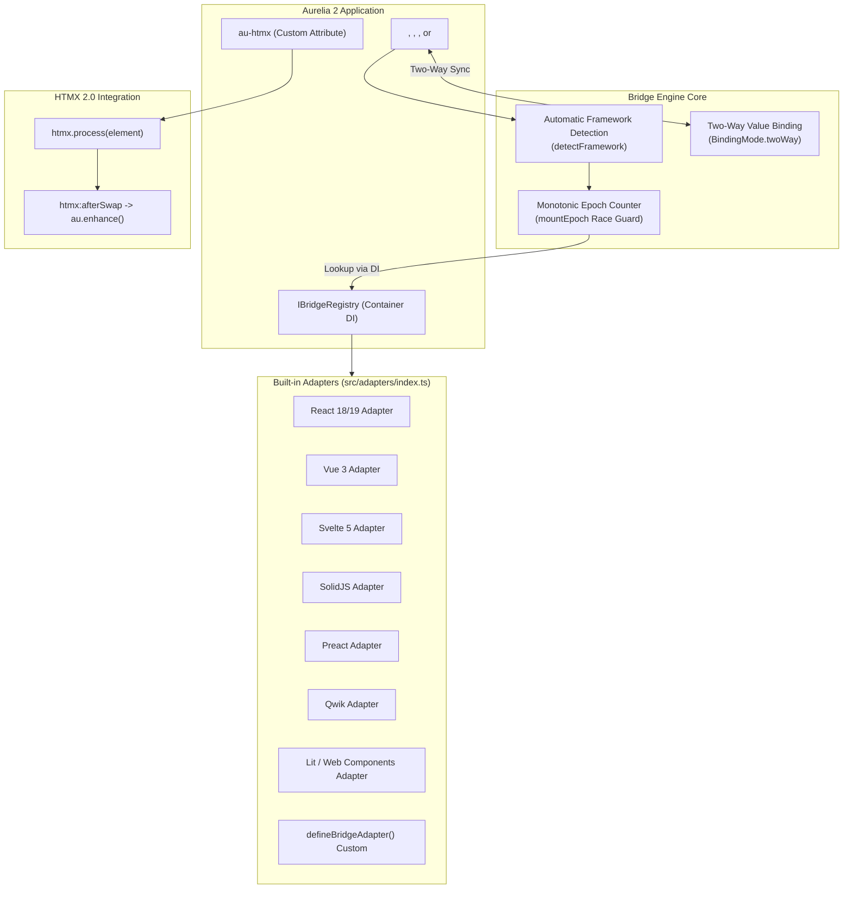

# `@aureliajs/bridge`

**Pure, Container-Scoped Polyglot Foreign Framework Interop & Hypermedia Bridge for Aurelia 2.**

[](https://aurelia.io)
[](https://www.typescriptlang.org/)
[](https://opensource.org/licenses/MIT)

> **Community Note:** `@aureliajs/bridge` is an independent open-source package by **Sandikodev ([@sandikodev](https://github.com/sandikodev))**. Real enterprise teams rarely rewrite an entire application overnight — they embed an existing React chart, a Vue design system widget, a Svelte 5 interactive control, or HTMX hypermedia regions inside Aurelia 2. `@aureliajs/bridge` makes that interop strictly typed, lazy, race-safe, DI-native, and follows **Convention over Configuration**.

---

## 1. Scope & Strict Boundaries

### What `@aureliajs/bridge` OWNS (**WHAT** foreign UI runtime mounts inside Aurelia)
- **Dedicated Convention Custom Elements**: `<au-react>`, `<au-vue>`, `<au-svelte>`, `<au-solid>`, `<au-preact>`, `<au-qwik>`, `<au-lit>` — zero-configuration wrappers with built-in framework pinning.
- **Universal `<au-bridge>` Custom Element**: Mounts foreign UI subtrees with **Automatic Framework Detection**, unified `component.bind` (eager classes, promises, or `() => import(...)`), reactive props forwarding, standardized `bridge-event` dispatch, and deterministic DI teardown.
- **Default Two-Way Value Binding**: `value.bind="count"` is two-way by default (`BindingMode.twoWay`) — eliminates tedious `on-change.bind="(v) => count = v"` synchronization boilerplate.
- **Dual-Style HTMX 2.0 Integration**:
  - `au-htmx` **Native Custom Attribute**: Enhances existing DOM elements directly with HTMX (`hx-get`, `hx-post`, `hx-swap`) — zero wrapper `<div>`s.
  - `<au-htmx>` **Declarative Custom Element**: Dedicated container element for declarative server-swapped hypermedia regions.
  - **Automatic Fragment Enhancement**: Automatically compiles and activates any Aurelia components or bridge elements inside server-rendered fragments on `htmx:afterSwap`!
- **Container-Scoped DI Services**: `IBridgeRegistry` and `IHtmx` services (never global mutable singletons!).
- **7 Built-in Lazy Adapters**: React 18/19, Vue 3, Svelte 5, SolidJS, Preact, Qwik, and Lit / W3C Custom Elements, plus `defineBridgeAdapter()` for any custom runtime (Three.js, D3, Monaco, MapLibre).
- **Smart Vite Plugin (`@aureliajs/bridge/vite`)**: On-the-fly compilation for Vue SFCs, Svelte 5 Runes, SolidJS JSX, and automatic dependency pre-bundling tailored strictly to installed packages.

### What `@aureliajs/bridge` Explicitly DOES NOT OWN
- Zero-JS partial hydration scheduling (`IntersectionObserver`, `requestIdleCallback`), or server routing. `@aureliajs/bridge` remains an unopinionated client mounting and interop engine for foreign frameworks and hypermedia.
- Forcing foreign dependencies: all foreign packages (`react`, `vue`, `svelte`, `solid-js`, `preact`, `qwik`, `lit`, `htmx.org`) are optional peer dependencies.

---

## 2. How It Works Under the Hood



1. **Container-Scoped DI (`IBridgeRegistry` & `IHtmx`)**:
   `BridgeConfiguration` registers a fresh `BridgeRegistry` instance **per Aurelia DI container** (`Registration.instance(IBridgeRegistry, ...)`). Two apps, micro-frontends, or parallel tests running in the same process never pollute each other's adapter registries.
2. **Automatic Framework Detection (`detectFramework`)**:
   When using `<au-bridge component.bind="MyWidget">`, the engine automatically detects the foreign ecosystem by inspecting component metadata:
   - Vue 3: detects `__vccOpts`, `setup`, or `.vue` SFC format.
   - Svelte 5 / 4: detects `$$render`, `$$`, or `.svelte` signatures.
   - Lit / Web Components: detects `HTMLElement` prototype or hyphenated tag name.
   - Qwik: detects `component$`, `qrl`, or resumability markers.
   - React / Preact / Solid: falls back cleanly or uses dedicated tags (`<au-solid>`, `<au-preact>`, `<au-react>`).
3. **Race-Safe Async Mounting (`mountEpoch`)**:
   Dynamic imports (`component.bind="() => import('./Chart.tsx')"`) are asynchronous. If the user navigates away or switches tabs before the `import()` finishes, a monotonic `mountEpoch` counter inside [src/au-bridge.ts](./src/au-bridge.ts) immediately discards stale mounts and calls `destroy()` on any late-resolved instance — preventing orphaned DOM nodes and memory leaks.
4. **Two-Way Value Binding by Default**:
   `value.bind` uses `BindingMode.twoWay`. When a foreign component invokes its `onChange(newValue)` callback, Aurelia automatically updates the bound ViewModel property without needing manual `on-change.bind="(v) => prop = v"`.
5. **Standardized Bi-Directional Event Protocol**:
   - **Aurelia → Foreign**: Props update reactively via `instance.update(nextProps)`.
   - **Foreign → Aurelia**: Foreign components can invoke generic `onEvent(eventName, payload)` or callbacks like `onSelect(val)`, `onSubmit(data)`. The bridge triggers bound callbacks and dispatches a bubbling, shadow-crossing W3C `CustomEvent('bridge-event', { detail: { framework, event, payload } })` on the host element.
6. **Error Boundary & Event Bubbling**:
   If a foreign component fails to mount or throws an error, the bridge invokes `on-error.bind="handleError"` and dispatches `bridge-error` (`detail: { framework, error }`).
7. **Zero-Wrapper Hypermedia (`au-htmx`) with Swapped-Fragment Enhancement**:
   `au-htmx` is an Aurelia Custom Attribute (`<section au-htmx hx-get="/feed">`). On `attached()`, it calls `htmx.process(element)`. Crucially, on `htmx:afterSwap`, it automatically calls `new Aurelia(container).enhance({ host: target })`, ensuring any nested Aurelia components or bridge elements inside the server-swapped HTML fragment come to life immediately!

---

## 3. Installation

```bash
bun add @aureliajs/bridge aurelia
# or npm / pnpm / yarn
npm install @aureliajs/bridge aurelia
```

All foreign framework packages (`react`, `react-dom`, `vue`, `svelte`, `solid-js`, `preact`, `@builder.io/qwik`, `lit`, `htmx.org`) are **optional peer dependencies** (`peerDependenciesMeta: optional: true`) — install only the ones your application actually uses.

---

## 4. Usage

### 1. Register `BridgeConfiguration`

```ts
import Aurelia from 'aurelia';
import { BridgeConfiguration } from '@aureliajs/bridge';
import { App } from './app.js';

// Standard registration (registers <au-bridge>, all 7 dedicated elements, and au-htmx)
Aurelia.register(BridgeConfiguration).app(App).start();
```

Customizing per container (e.g., adding custom adapters, disabling built-ins, or injecting an explicit `htmx` instance):

```ts
Aurelia.register(
  BridgeConfiguration.customize({
    registerBuiltins: true,
    adapters: [myThreeJsAdapter],
    htmx: myHtmxModule,
  })
).app(App).start();
```

---

### 2. Mounting Foreign Components

#### Option A: Dedicated Convention Elements (Recommended)

Dedicated custom elements provide the cleanest DX by eliminating the `using="..."` attribute:

```ts
// analytics-dashboard.ts
import { ReactChart } from './react/ReactChart';
import VueDataGrid from './vue/VueDataGrid.vue';
import SvelteCounter from './svelte/SvelteCounter.svelte';

export class AnalyticsDashboard {
  public ReactChart = ReactChart;
  public VueDataGrid = VueDataGrid;
  public SvelteCounter = SvelteCounter;

  public chartData = { metric: 'MRR', value: 42000 };
  public sharedCount = 10;

  // Dynamic import keeps the bundle slim until needed
  public loadHeavyWidget = () => import('./solid/SolidWidget');

  public handleChartEvent(event: string, payload: unknown) {
    console.log('Chart event:', event, payload);
  }
}
```

```html
<!-- analytics-dashboard.html -->

<!-- 1. React 19 via <au-react> -->
<au-react
  component.bind="ReactChart"
  props.bind="chartData"
  on-event.bind="handleChartEvent">
</au-react>

<!-- 2. Vue 3 SFC with Two-Way Value Binding (<au-vue>) -->
<!-- When Vue triggers onChange(20), sharedCount updates automatically in Aurelia! -->
<au-vue
  component.bind="VueDataGrid"
  value.bind="sharedCount">
</au-vue>

<!-- 3. Svelte 5 Runes via <au-svelte> -->
<au-svelte
  component.bind="SvelteCounter"
  value.bind="sharedCount">
</au-svelte>

<!-- 4. SolidJS with Lazy Dynamic Import (<au-solid>) -->
<au-solid
  component.bind="loadHeavyWidget"
  props.bind="{ theme: 'dark' }">
</au-solid>

<!-- 5. Preact (<au-preact>) -->
<au-preact
  component.bind="PreactWidget"
  value.bind="sharedCount">
</au-preact>

<!-- 6. Qwik Resumable (<au-qwik>) -->
<au-qwik
  component.bind="QwikWidget"
  value.bind="sharedCount">
</au-qwik>

<!-- 7. Lit / Web Components (<au-lit>) -->
<au-lit
  component="my-custom-tag"
  props.bind="{ active: true }">
</au-lit>
```

#### Option B: Universal `<au-bridge>` with Automatic Detection

If you prefer a single universal tag, `<au-bridge>` automatically detects the target framework:

```html
<!-- Automatically detected as Vue 3 SFC -->
<au-bridge component.bind="VueDataGrid" value.bind="sharedCount"></au-bridge>

<!-- Automatically detected as Svelte 5 -->
<au-bridge component.bind="SvelteCounter" value.bind="sharedCount"></au-bridge>

<!-- Explicit override if needed -->
<au-bridge using="react" component.bind="ReactChart" props.bind="chartData"></au-bridge>
```

---

### 3. Hypermedia Integration with HTMX 2.0 (`au-htmx` & `<au-htmx>`)

HTMX is fundamentally different from client-side component engines (React, Vue, Svelte). It does not maintain virtual DOMs or local JavaScript state; instead, it streams server-rendered HTML partials over standard HTTP.

`@aureliajs/bridge` provides two idiomatic ways to integrate HTMX:

#### Style 1: Native Custom Attribute (`au-htmx`)
Enhance any semantic HTML5 element directly without wrapper `<div>` nodes:

```html
<!-- Direct Hypermedia Trigger on Semantic Elements -->
<section au-htmx hx-get="/partials/activity-feed" hx-trigger="revealed" hx-swap="innerHTML">
  Loading feed...
</section>

<!-- Automatic Aurelia Enhancement on Swapped Content -->
<div au-htmx>
  <button class="btn btn-primary" hx-get="/api/widgets" hx-target="#widget-zone" hx-swap="innerHTML">
    ⚡ Fetch Server Partial
  </button>
  <div id="widget-zone">
    <!-- Any <au-react>, <au-vue>, or native Aurelia component inside the fetched HTML fragment
         is automatically compiled and enhanced by Aurelia upon arrival! -->
  </div>
</div>
```

#### Style 2: Declarative Custom Element (`<au-htmx>`)
Use `<au-htmx>` when you prefer a self-contained declarative container for server-swapped regions:

```html
<!-- Automatically fetches /api/stats on load and swaps innerHTML -->
<au-htmx from="/api/stats" trigger="load" swap="innerHTML">
  <p class="placeholder">Loading server partial...</p>
</au-htmx>
```

---

### 4. Authoring a Custom Adapter (`defineBridgeAdapter`)

Any third-party or imperative library (Monaco Editor, D3, Three.js, MapLibre) can be bridged using the standard contract:

```ts
import { defineBridgeAdapter } from '@aureliajs/bridge';

interface MapProps {
  center: [number, number];
  zoom: number;
}

export const mapAdapter = defineBridgeAdapter<MapProps>({
  framework: 'maplibre',
  mount({ container, props, onEvent }) {
    const map = new maplibregl.Map({
      container,
      center: props.center,
      zoom: props.zoom,
    });

    map.on('click', (e) => onEvent?.('click', e.lngLat));

    return {
      nativeInstance: map,
      update(nextProps) {
        if (nextProps.center) map.setCenter(nextProps.center);
        if (nextProps.zoom !== undefined) map.setZoom(nextProps.zoom);
      },
      destroy() {
        map.remove();
      },
    };
  },
});
```

Register it in your Aurelia configuration:

```ts
Aurelia.register(
  BridgeConfiguration.customize({
    adapters: [mapAdapter],
  })
);
```

And mount it seamlessly:

```html
<au-bridge using="maplibre" component.bind="mapInstance" props.bind="mapSettings"></au-bridge>
```

---

## 5. Built-in Adapters: Exact Behavior & Honest Trade-offs

We openly document each adapter's runtime mechanics ([src/adapters/index.ts](./src/adapters/index.ts)):

| Framework | Element Tag | Underlying Mount API | How `update(nextProps)` Works | Honest Trade-offs / Notes |
| :--- | :--- | :--- | :--- | :--- |
| **`react`** | `<au-react>` | `ReactDOM.createRoot(el)` + `root.render(...)` | Re-renders root with merged props | Full React 18/19 concurrent root support; clean `root.unmount()`. |
| **`vue`** | `<au-vue>` | `createApp({ render: () => h(Comp, reactiveProps) })` | Mutates Vue `reactive()` object via `Object.assign` | Preserves Vue component internal state across prop updates; clean `app.unmount()`. |
| **`svelte`** | `<au-svelte>` | Svelte 5 `mount(Comp, { target, props })` | Calls `$set()` if Svelte 4; on Svelte 5 calls `unmount()` + re-`mount()` | Clean Svelte 5 Runes support. Wrapping props in `$state` proxy can be explored in future Svelte releases. |
| **`solid`** | `<au-solid>` | `render(() => Comp(reactiveProxy), el)` + `createSignal` | Updates signal via `setProps()`, read through reactive `Proxy` | Fine-grained reactivity without remounting the Solid tree; clean `dispose()`. |
| **`preact`** | `<au-preact>` | `render(h(Comp, props), el)` | Re-renders VNode into container | Ultra-small (3 KB) footprint; teardown calls `render(null, el)`. |
| **`qwik`** | `<au-qwik>` | Client-side `render(host, jsx(Comp, props))` + Qwikloader | Re-renders JSX node into host | Runs Qwik client renderer inside Aurelia with inlined QRL event boundaries; teardown clears container. |
| **`lit`** | `<au-lit>` | `document.createElement(tag)` or `new CustomElementClass()` | Reflects props directly onto element properties | Zero external runtime overhead; standard W3C Web Component lifecycle. |

---

## 6. Subpath Contract & Key Exports

| Subpath | Runtime Dependencies | Key Exports |
| :--- | :--- | :--- |
| **`@aureliajs/bridge`** | `aurelia` | `BridgeConfiguration`, `AuBridge`, `<au-react>` (`AuReact`), `<au-vue>` (`AuVue`), `<au-svelte>` (`AuSvelte`), `<au-solid>` (`AuSolid`), `<au-preact>` (`AuPreact`), `<au-qwik>` (`AuQwik`), `<au-lit>` (`AuLit`), `AuHtmx`, `detectFramework`, `IBridgeRegistry`, `IHtmx`, `BridgeRegistry`, `createDefaultBridgeRegistry`, `defineBridgeAdapter`, all 7 `create*Adapter()` factories, generic types |
| **`@aureliajs/bridge/adapters`** | **None (0 KB Aurelia)** | `BridgeRegistry`, `createDefaultBridgeRegistry`, `createReactAdapter`, `createVueAdapter`, `createSvelteAdapter`, `createSolidAdapter`, `createPreactAdapter`, `createQwikAdapter`, `createLitAdapter` (usable independently in headless environments, micro-frontends, or custom vanilla runtimes without Aurelia) |
| **`@aureliajs/bridge/vite`** | `vite` | `bridge()`, `bridgePlugin` (Smart Vite plugin providing on-the-fly compilation for Vue SFCs, Svelte 5 runes, SolidJS JSX, HTMX dev mock endpoints, and selective pre-bundling) |

---

## 7. Smart Vite Plugin (`@aureliajs/bridge/vite`)

To avoid configuring Babel, `@vue/compiler-sfc`, and Svelte compilers manually in your `vite.config.ts`, simply include `bridge()`:

```ts
// vite.config.ts
import { defineConfig } from 'vite';
import aurelia from '@aurelia/vite-plugin';
import { bridge } from '@aureliajs/bridge/vite';

export default defineConfig({
  plugins: [
    bridge(),
    aurelia({ useDev: false }),
  ],
});
```

### Why it's smart:
- **Selective Dependency Optimization**: Inspects your project's `package.json` and only adds installed frameworks to Vite's `optimizeDeps.include`. If you only use React, it will never warn about missing Vue or Svelte packages!
- **Automatic JSX Pragmas**: Automatically applies `@jsxImportSource preact` or `@builder.io/qwik` for relevant files.
- **Built-in Dev Mock API**: Automatically provides a live hypermedia mock endpoint at `/api/htmx-demo` for rapid prototyping.

---

## 8. Testing & Development

Run the comprehensive test suite across unit and integration tests:

```bash
cd packages/aurelia-bridge
bun run build        # Typecheck and compile dist/
bun run typecheck    # Validate strict TypeScript types
bun test             # Run package test suite & example tests
```

To run the interactive polyglot example application:

```bash
cd packages/aurelia-bridge/example
bun install
bun run dev          # Starts Vite dev server at http://localhost:5173
```
